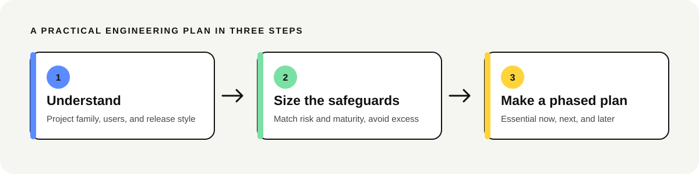

# Engineering Advisor

Get an engineering plan that fits the project you actually have. This open skill classifies a project by family, risk, maturity, and release style, then recommends practical engineering steps without adding process for its own sake.



## What it does

- Inspects an available repository read-only before making recommendations.
- Classifies the project and explains the decisions that matter.
- Builds a plan for what to do now, next, and later.
- Keeps the security floor tied to real risk, even for a small project.

It covers architecture, Git workflow, testing, CI/CD, environments, deployment, rollback, security, and maintenance. It also explains when practices such as GitFlow, staging branches, microservices, or Kubernetes are unnecessary.

## Install

### Claude Code

Add the repository marketplace and install the plugin:

```text
/plugin marketplace add Achal13jain/engineering-advisor
/plugin install engineering-advisor@engineering-advisor
```

Invoke it directly with `/engineering-advisor:engineering-advisor`, or ask Claude Code an engineering workflow question.

### Other agents

Install with the skills CLI:

```bash
npx skills add Achal13jain/engineering-advisor
```

## Try it

- “Do I need a develop or staging branch for this project?”
- “Review this repository and identify the most important gaps before launch. Do not change anything.”
- “We are adding payments to our SaaS. What safeguards should be in place before release?”

## Project contents

- `skills/engineering-advisor/` is the portable skill.
- `.claude-plugin/` contains the Claude Code plugin and marketplace manifests.
- `docs/` contains the project home page and its local assets.
- `evals/` contains scenarios and fixture projects used to assess recommendations.
- `tools/check_skill.py` and `tools/verified_sources.json` support the structural checks in CI.

## Safety

The skill inspects repositories read-only by default. It does not discard work, run destructive Git commands, or change repository, deployment, or production settings without explicit approval. It is an advisor, not a security auditor or a source of legal or compliance advice.

## Contributing and security

See [CONTRIBUTING.md](CONTRIBUTING.md) to report advice problems or propose changes. Report security issues privately as described in [SECURITY.md](SECURITY.md).

## License

[MIT](LICENSE). Created and maintained by [Achal Jain](https://github.com/Achal13jain).
